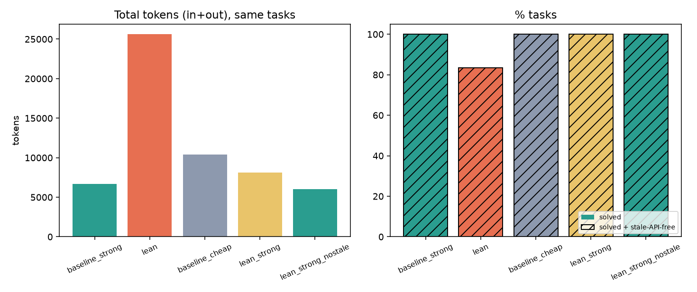

# LeanCoder — a coding agent that gets the job done with as few tokens as possible

Built for the **Global AI Hackathon (HackCulture)**: Bifrost problem statement *"Build a coding agent that gets the job done with as few tokens as possible"*, plus the Tavily add-on *"Stale answer detector for AI applications"*.

LeanCoder fixes failing tests in a Python repo while sending the model as little as possible, routes **every** LLM call through a local [Bifrost](https://github.com/maximhq/bifrost) gateway, and uses **Tavily** to catch deprecated / removed APIs (and stale answers in general) before they ship.

> **Honest summary of the results (details below):** on our 6-task mini benchmark with free OpenRouter models, the lean pipeline with a token-efficient model used **10% fewer total tokens** than a naive whole-repo / whole-file agent (same model, same 6/6 solved). Turning the Tavily stale-API guard on adds judge calls and makes the run cost *more* tokens (+21% vs baseline) — it is a safety feature, not a token saver — and its judge never had to flag anything on these tasks because the models already wrote modern code. A cheap→strong cascade with a *reasoning* "cheap" model was the worst option (+282%). The benchmark is tiny; read it as direction, not proof.

## How it works

```
failing tests ─► localizer (traceback + AST + ripgrep) ─► minimal prompt (only relevant functions + constants)
      ▲                                                        │
      │                                              Bifrost gateway  (OpenAI-compatible, fallbacks, retries, logs)
      │                                                        │
   run tests ◄── apply SEARCH/REPLACE edit ◄───────────── LLM reply (tiny diff, not whole files)
      │ green
      ▼
 Tavily stale-API check (APIs added by the patch) ─► judge (must quote the docs) ─► auto-fix ─► tests again ─► done
 red → revert, add compact failure to the prompt, escalate to the next model
```

Token-saving levers (each is in the code):

1. **Localize first** (`leancoder/locate.py`): pytest traceback frames → enclosing function via `ast`; definitions of functions the failing test calls via `ripgrep`; module-level constants/tables the function reads; only the imports of touched files. No whole files.
2. **Output as SEARCH/REPLACE edits** (`leancoder/edits.py`) — a few dozen tokens instead of rewriting a file. Tolerant parser: markdown fences, line-range replies, indentation- and blank-line-insensitive matching. Tests are read-only.
3. **Tests gate everything** (`leancoder/agent.py`): stop at green; on failure revert, feed back a *compact* failure (library frames and caret lines stripped), then escalate.
4. **Everything through Bifrost** (`leancoder/llm.py`): one OpenAI-compatible endpoint, per-request `fallbacks` (a rate-limited model falls back to the next one), retry policy, request logs, and gateway-side token accounting (`results/bifrost_stats.json`). The client also keeps its own meter per task.
5. **Tavily stale-API guard** (`leancoder/stale.py`): extracts the library APIs a patch *adds*, searches Tavily for their deprecation status, a keyword gate skips the LLM when the docs show no deprecation language, and an LLM judge must return a **verbatim quote that really occurs in the retrieved text** (hallucination guard). Flagged usage is rewritten and re-tested; the rewrite is reverted if tests break.

## Technologies and what each contributes

| Tech | Role |
|---|---|
| **Bifrost** (`@maximhq/bifrost`, local gateway on `127.0.0.1:8089`) | single gateway for all LLM calls, fallbacks/retries, logs, token accounting; configured from `.env` by `scripts/gen_bifrost_config.py` |
| **Tavily Search** | fresh documentation for the API a patch adds; evidence source of the standalone stale answer detector |
| OpenRouter free models (`nvidia/nemotron-3.5-lightning:free`, `nvidia/nemotron-3-ultra-550b-a55b:free`) | the LLMs (provider is swappable: Groq / Cerebras / OpenRouter presets in `leancoder/config.py`) |
| ripgrep, Python `ast`, pytest | localization and verification |
| python-pptx, matplotlib | pitch deck and charts |

## Install

Requirements: Linux/macOS, Python 3.10+, Node.js 18+ (for `npx`), `ripgrep` (optional, falls back to a Python scan).

```bash
git clone <this repo> && cd leancoder
python3 -m venv .venv && .venv/bin/pip install pytest pandas numpy requests python-pptx matplotlib
cat > .env <<'ENV'            # never commit this file (it is git-ignored)
OPENROUTER_API_KEY=...        # or GROQ_API_KEY / CEREBRAS_API_KEY
TAVILY_API_KEY=...
ENV
```

## Run

```bash
source .env.sh                          # keeps tmp/caches inside the project
scripts/run_bifrost.sh &                # start the gateway on :8089 (reads keys from .env)
.venv/bin/python -m pytest -q           # offline unit tests (no API calls)

# benchmark: results are appended to results/raw.jsonl; LLM replies are cached in results/cache,
# so re-running this repo's benchmark costs 0 live requests
.venv/bin/python bench/run_bench.py --agents baseline_strong,lean_strong_nostale,lean_strong,lean,baseline_cheap \
    --tasks t03,t05,t07,t08,t09,t10
.venv/bin/python bench/report.py        # -> results/RESULTS.md, results/chart.png
.venv/bin/python bench/run_bench.py --mock   # dry run with an oracle mock (no network)

# standalone stale answer detector
.venv/bin/python -m leancoder.stale_cli --qa examples/qa_samples.json --limit 3 --max-claims 1
.venv/bin/python -m leancoder.stale_cli --question "..." --answer "..."
# in-agent guard demo: a patch that passes tests but uses utcnow()
.venv/bin/python scripts/stale_patch_demo.py
```

Free-tier protection: a persistent daily live-call budget (`LEAN_MAX_LIVE_CALLS_PER_DAY`, default 48), pacing between calls, no blind retries, and a disk cache of replies (`results/cache`).

Provider/model selection: whichever of `GROQ_API_KEY`, `CEREBRAS_API_KEY`, `OPENROUTER_API_KEY` is present (force with `LEAN_PROVIDER`); override models with `LEAN_CHEAP_MODEL` / `LEAN_STRONG_MODEL`; prices for cost estimates in `leancoder/config.py` (`LEAN_PRICES` to override).

## Benchmark

10 tiny bug-fix repos in `tasks/` (each with pytest, a golden solution verified by the unit tests). Three carry **deprecated-API bait**: `pandas.DataFrame.append` (removed in pandas 2), `datetime.utcnow()` and `datetime.utcfromtimestamp()` (deprecated in Python 3.12; the repo contains legacy code using them, so a model that copies the repo style writes stale code that still passes the tests). The live run used 6 of the 10 tasks (`t03, t05, t07, t08, t09, t10`) because the free OpenRouter tier allows ~50 requests/day for the whole account.

Agents: `baseline_*` = naive agent (every source + test file in the prompt, whole-file rewrites, 2 attempts); `lean` = cheap model first then strong on failure (cascade); `lean_strong` = token-efficient model only, with the Tavily guard; `lean_strong_nostale` = same without the guard. `*_strong` = `nemotron-3-ultra-550b-a55b:free`, `*_cheap`/cascade tier 1 = `nemotron-3.5-lightning:free`.

Models: cheap=`nvidia/nemotron-3.5-lightning:free`, strong=`nvidia/nemotron-3-ultra-550b-a55b:free` (all calls via Bifrost). Tasks compared: 6 (t03_mutable_default, t05_duration, t07_lru_cache, t08_pandas_append, t09_token_expiry, t10_event_iso).

| Agent | Solved | Stale-API-free | Tokens in | Tokens out | Total tokens | LLM calls | Est. cost (list price) |
|---|---|---|---|---|---|---|---|
| baseline_strong | 6/6 (100%) | 6/6 | 4,392 | 2,318 | 6,710 | 6 | $0.0082 |
| lean | 5/6 (83%) | 5/6 | 6,692 | 18,922 | 25,614 | 12 | $0.0077 |
| baseline_cheap | 6/6 (100%) | 6/6 | 4,392 | 6,017 | 10,409 | 6 | $0.0015 |
| lean_strong | 6/6 (100%) | 6/6 | 4,798 | 3,334 | 8,132 | 9 | $0.0109 |
| lean_strong_nostale | 6/6 (100%) | 6/6 | 3,970 | 2,070 | 6,040 | 7 | $0.0073 |

Change vs `baseline_strong` (negative = fewer / cheaper than baseline):

| Agent | Total tokens | Input tokens | Output tokens | Est. cost | Solved |
|---|---|---|---|---|---|
| lean | +282% | +52% | +716% | -6% | 5/6 vs 6/6 |
| baseline_cheap | +55% | +0% | +160% | -82% | 6/6 vs 6/6 |
| lean_strong | +21% | +9% | +44% | +33% | 6/6 vs 6/6 |
| lean_strong_nostale | -10% | -10% | -11% | -10% | 6/6 vs 6/6 |

Cost is estimated at OpenRouter list prices of the paid twin of each ':free' model (actual spend: $0). Hidden reasoning tokens are included in 'Tokens out'.

#### Per task

| Task | Trap | baseline_strong: solved / tokens / calls / stale-free | lean: solved / tokens / calls / stale-free | baseline_cheap: solved / tokens / calls / stale-free | lean_strong: solved / tokens / calls / stale-free | lean_strong_nostale: solved / tokens / calls / stale-free |
|---|---|---|---|---|---|---|
| t03_mutable_default | - | ✅ / 1,008 / 1 / ✅ | ✅ / 2,498 / 1 / ✅ | ✅ / 1,376 / 1 / ✅ | ✅ / 842 / 1 / ✅ | ✅ / 842 / 1 / ✅ |
| t05_duration | - | ✅ / 1,253 / 1 / ✅ | ✅ / 4,393 / 2 / ✅ | ✅ / 1,359 / 1 / ✅ | ✅ / 864 / 1 / ✅ | ✅ / 839 / 1 / ✅ |
| t07_lru_cache | - | ✅ / 1,271 / 1 / ✅ | ✅ / 4,093 / 2 / ✅ | ✅ / 1,711 / 1 / ✅ | ✅ / 862 / 1 / ✅ | ✅ / 863 / 1 / ✅ |
| t08_pandas_append | deprecated_api:pandas.DataFrame.append | ✅ / 909 / 1 / ✅ | ✅ / 4,714 / 2 / ✅ | ✅ / 3,091 / 1 / ✅ | ✅ / 1,740 / 2 / ✅ | ✅ / 819 / 1 / ✅ |
| t09_token_expiry | deprecated_api:datetime.utcnow (bait in repo) | ✅ / 1,146 / 1 / ✅ | ✅ / 5,353 / 3 / ✅ | ✅ / 1,426 / 1 / ✅ | ✅ / 1,842 / 2 / ✅ | ✅ / 666 / 1 / ✅ |
| t10_event_iso | deprecated_api:datetime.utcfromtimestamp (bait in repo) | ✅ / 1,123 / 1 / ✅ | ❌ / 4,563 / 2 / ❌ | ✅ / 1,446 / 1 / ✅ | ✅ / 1,982 / 2 / ✅ | ✅ / 2,011 / 2 / ✅ |

#### Stale-API guard activity (agents with the guard on)

- `lean` **t08_pandas_append**: 2 Tavily queries, 1 judged; flagged: none; auto-fixed: False
- `lean` **t09_token_expiry**: 1 Tavily queries, 1 judged; flagged: none; auto-fixed: False
- `lean_strong` **t08_pandas_append**: 2 Tavily queries, 1 judged; flagged: none; auto-fixed: False
- `lean_strong` **t09_token_expiry**: 1 Tavily queries, 1 judged; flagged: none; auto-fixed: False
- `lean_strong` **t10_event_iso**: 1 Tavily queries, 1 judged; flagged: none; auto-fixed: False



**What the numbers say, without spin**

- Lean context works per call: the average prompt is ~567 input tokens for `lean_strong_nostale` vs ~732 for the baseline (−23%) even though these toy repos are tiny; the gap should grow with repo size (not measured here).
- The cheapest-per-token model is not the cheapest-per-task model: `nemotron-3.5-lightning` is a reasoning model, its hidden thinking (1–3k tokens per call) made `lean` (cascade) cost 3.8× the baseline's tokens and fail one task. `baseline_cheap` is 82% cheaper in *dollars* than `baseline_strong` (list prices) but uses 55% more tokens.
- The Tavily guard costs tokens (judge call per candidate API when docs mention deprecations) and found nothing to flag in these 6 runs — the models wrote modern code on their own. It *does* work when stale code appears: see the demos below.
- Iterations are documented in `results/history/` (earlier prompt/parser versions, kept for transparency). The first versions of the lean agent lost tasks to formatting problems (model ignored the edit format; a SEARCH block spanned a blank-line difference; a constant table was outside the localized function) — fixed in `edits.py`/`locate.py`/`prompts.py`, then the affected runs were redone.
- n = 6 tasks, one run each at temperature 0: no confidence intervals. Free-tier models also change under you.

### Stale answer detector — live demo (`results/stale_demo.md`)

Model (via Bifrost): `nvidia/nemotron-3-ultra-550b-a55b:free`; evidence: Tavily Search.

#### STALE: How do I append a row to a pandas DataFrame?

Answer under test: _Use df = df.append({'name': 'x', 'qty': 1}, ignore_index=True). DataFrame.append is the standard way to add a row._

- **STALE** - DataFrame.append() is the standard way to add a row to a pandas DataFrame
  - why: DataFrame.append() was deprecated in pandas 1.4.0 and completely removed in pandas 2.0; the recommended method is now concat().
  - current: DataFrame.append() is removed; use pandas.concat() to add rows.
  - source: https://builtin.com/articles/attributeerror-dataframe-object-has-no-attribute-append
  - quote: "Now that the `append()` method (deprecated as of v1.4.0) has been completely removed as of Pandas 2.0, the new `concat()` method should be used instead."

#### STALE: How do I get the current UTC time in Python?

Answer under test: _Call datetime.datetime.utcnow(); it is the recommended way to get the current UTC time._

- **STALE** - datetime.datetime.utcnow() is the recommended way to get current UTC time
  - why: datetime.datetime.utcnow() is deprecated since Python 3.12 and scheduled for removal; the recommended approach is datetime.datetime.now(datetime.UTC).
  - current: Use datetime.datetime.now(datetime.UTC) to get current UTC time.
  - source: https://github.com/boltgolt/howdy/issues/996
  - quote: "datetime.datetime.utcnow() is deprecated and scheduled for removal in a future version. Use timezone-aware objects to represent datetimes in UTC: datetime.datetime.now(datetime.UTC)."

#### FRESH: How do I read a CSV file into pandas?

Answer under test: _Use pandas.read_csv('file.csv'), which returns a DataFrame._


Tokens used: 1623 in / 2056 out over 5 calls (est. $0.0059 at list price).

### In-agent stale-API guard — live demo (`results/stale_patch_demo.md`)

Patch applied, tests green: True
Patch line: `return token["expires_at"] < datetime.utcnow().replace(tzinfo=timezone.utc)`
Findings: [{'api': 'datetime.datetime.utcnow', 'line': 'return token["expires_at"] < datetime.utcnow().replace(tzinfo=timezone.utc)', 'stale': True, 'replacement': 'datetime.now(timezone.utc)', 'reason': 'deprecated/removed per fresh docs', 'url': 'https://andreas.scherbaum.la/post/2024-08-05_deprecationwarning-datetime-datetime-utcnow-is-deprecated-and-scheduled-for-removal-in-a-future-version-use-timezone-aware-objects-to-represent-datetimes-in-utc-datetime-datetime-now-datetime-utc', 'quote': 'The fix for this is rather easy: replace `utcnow()` with `now(datetime.UTC)`.'}]
Auto-fixed: True; tests green after fix: True
Final line: `return token["expires_at"] < datetime.now(timezone.utc)`
Tokens: 1089 in / 1004 out over 2 calls; Tavily queries: 1

## Repository layout

```
leancoder/        agent.py baseline.py locate.py edits.py stale.py stale_cli.py llm.py config.py tavily.py runner.py prompts.py mock.py
tasks/            10 mini repos (task.json, repo/ with pytest, solution.edits)
bench/            run_bench.py report.py
scripts/          run_bifrost.sh gen_bifrost_config.py make_deck.py stale_patch_demo.py gateway_stats.py ping.py
examples/         qa_samples.json
tests/            offline unit tests
results/          RESULTS.md chart.png raw.jsonl cache/ stale_demo.md stale_patch_demo.md bifrost_stats.json history/
```

## Limitations

- Tiny benchmark, free models, 50 requests/day: indicative only; not SWE-bench.
- Bifrost's semantic/direct cache needs a Redis-Stack or vector store; it is **not** enabled here. We use an on-disk reply cache instead. Bifrost fallbacks are configured per request (`fallbacks`), but the cheap→strong *escalation on test failure* is application logic, because a gateway cannot know a patch failed tests.
- Single-language (Python), single-file-ish edits, pytest only.
- The stale guard needs Tavily credits; without `TAVILY_API_KEY` it is skipped.

## License

MIT

_Note: `results/bifrost_stats.json` is the gateway's own counter over the whole development session (probes, discarded runs, 429s included), so it is larger than the benchmark totals above._
